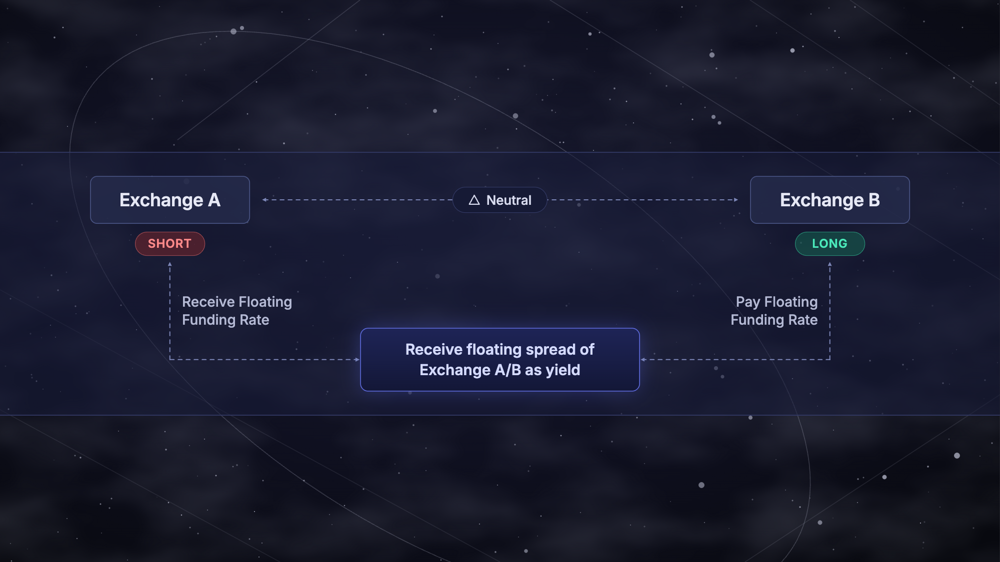
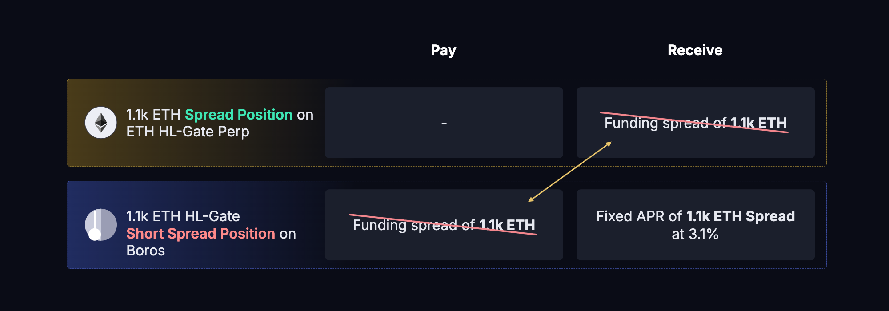
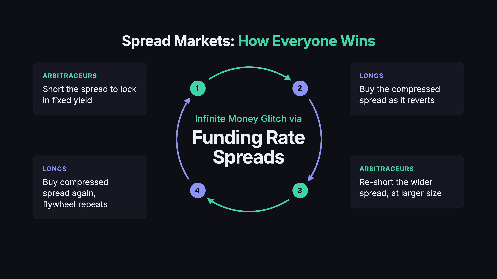

# Fixed Return Funding Arbitrage

**Can you get delta-neutral, fixed yield between two perp markets?**

Before Boros, this trade was fraught with risks from funding rate volatility. Now, it’s a viable, repeatable yield strategy.

## How it works

Because platforms have different liquidity, trader flows, market sentiment, and risk models, perp funding rates often do not move in sync. These structural differences between platforms can create persistent opportunities to arbitrage the spread between funding rates.

## Traditional naked arbitrage (without Boros)

The classic approach is simple on paper: take opposite perp positions on two exchanges to capture the difference in funding rates.

**But in practice, it is operationally heavy.**

**This trade comes with “hidden” complications:**

* Funding rate spreads are floating spreads, and when funding rates flip, you can end up in the negative.
* **During volatile market conditions, accounts may need to be rebalanced and adjusted accordingly, and liquidation risks increase.**

**But with Boros, this trade becomes a stable, fixed-yield trade with zero directional exposure.**

## Fixed Returns via Boros Spread Markets

Boros [spread markets](spread-markets-101) isolate this funding rate gap, and make it easy for you to turn these floating spreads into fixed yield in just 2 steps.

1. **Long the perp with lower funding, short the perp with higher funding**

This earns you the spread between the 2 funding rates. Higher leverage on the perps raises your return on capital, but also your liquidation risk. Note: the spread is floating and can move against you.

<figure><figcaption></figcaption></figure>

2. **Sell the floating spread on Boros for a fixed spread.**

**A fixed spread means fixed return.** The only thing you have to manage now is your collateral on the perps and Boros.

Simply short the spread market on Boros for the same notional as your perp positions.

### What the numbers look like

**Assume that ETH funding is higher on Hyperliquid than on Gate, and the implied APR of the ETH HL-Gate spread market is 3.1%.**

You short ETH on Hyperliquid and long ETH on Gate, setting up a floating spread.

Then, you sell the ETH floating spread on Boros at 3.1%, and receive 3.1% APR until the spread market matures.

<figure><figcaption></figcaption></figure>

With our [Arbitrage terminal](/boros-docs/arbitrage-with-crossex/overview), capturing yield opportunities like this on Boros is simple and fuss-free. The terminal helps you manage perp positions in-app, and the only collateral requiring management is your margin on the Boros side.

Longs capture the difference between the implied and underlying spread, creating a win-win flywheel for sellers who want fixed spreads. See [the PvE nature of spread markets](spread-markets-101#the-pve-nature-of-spread-markets) for how it works.

<figure><figcaption></figcaption></figure>

## The Benefits of this Strategy

Executing this arbitrage with Boros comes with significant benefits, such as:

* **Funding rate volatility risk is eliminated.** Traders do not need to worry about swings in funding rates, only their implied APR entry on Boros.
* **Fixed-yield strategy.** When funding rates between platforms diverge, Boros allows traders to take advantage of a time-sensitive arbitrage and farm its yield until market maturity.
* **Longer-duration arbitrage (more potential yield).** With the removal of rate volatility, this arbitrage can be executed for longer time periods, allowing traders to capture a larger share of the available yield.
* **Negative funding ceases to be an issue.** Previously, traders executing this arbitrage had to unwind positions when rates went negative.
* **Delta-neutral exposure while farming yield.** Directional price risk is non-existent on this trade, due to being delta-neutral. Boros unlocks yield farming from discrepancies between perp funding rates.
* **One Boros position.** The spread market covers both funding rates in a single short spread position. One order means no risk of only one leg filling, and with one margin requirement a sharp move in a single exchange's rate can't liquidate one leg on its own.

## Using the Boros Strategy Dashboard

The Boros Strategy Dashboard makes spotting arbitrage opportunities and executing them quick and easy.

The dashboard highlights currently available arbitrage opportunities, and the possible fixed yields with Boros.

[Simply load up the dashboard](https://boros.pendle.finance/strategy), select the arbitrage you would like to set up, and follow the steps to unlock fixed yield.

Note: The possible yield from this arbitrage is determined by your leverage on the perp side of the trade. As such, adjust perp leverage in the strategy calculator according to your risk appetite.

**For a detailed overview of this strategy, and the average returns from it on BTC and ETH, check out our [in-depth report here](https://x.com/boros_fi/status/2001831621817962761).**
