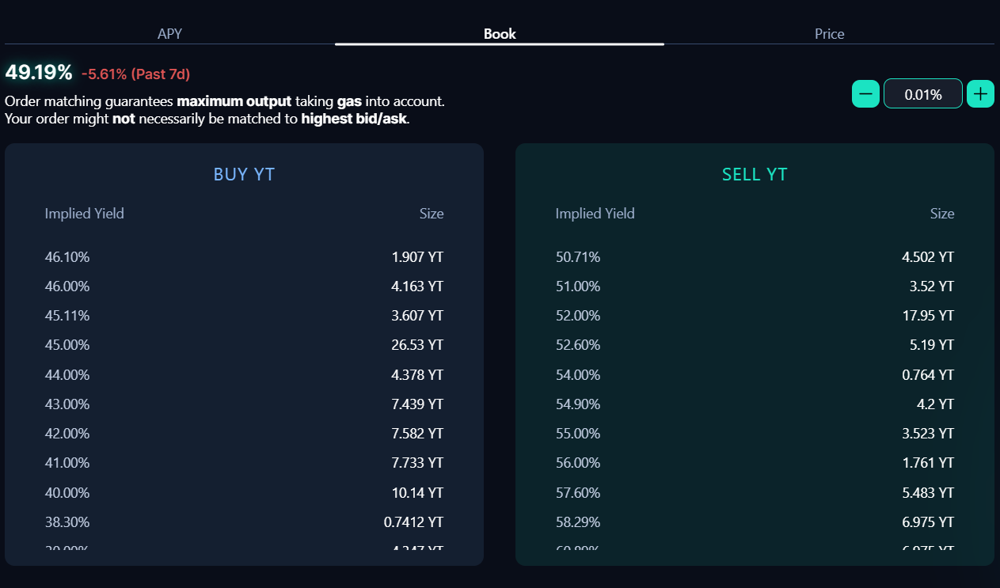

# Limit Orders

Users can trade PT and YT peer to peer with limit orders, next to the AMM. A maker signs an order to buy or sell at a set implied APY. A taker fills the order through the Limit Order contract, which settles the trade between the two users. You can place limit orders on PT and YT of supported assets on any chain, and most popular markets support them.

For the role of each party, see [Who Does What](/pendle-v2-dev/LimitOrder/WhoDoesWhat).

## When an Order Gets Filled

An order is filled only when a taker chooses to fill it. Takers usually fill an order when its implied APY is better than the AMM rate. When a swap goes through the Pendle Router, the Router fills the orders that the caller passes, then trades the rest on the AMM. So an order adds liquidity at its implied APY: a swap in that direction can fill the order before it moves the AMM rate further.

A quote from the Pendle Hosted SDK can split a swap between the AMM and limit orders to reduce price impact. The user reviews the quote and signs the transaction. Other routers and takers can compute their own split. The quote also counts the gas cost of each fill, so small orders are less likely to be included, mainly on chains with high gas fees.

[Flash swap](https://docs.pendle.finance/pendle-v2/ProtocolMechanics/LiquidityEngines/AMM#flash-swaps) between PT and YT lets a taker who buys YT fill a maker's order to buy PT, and a taker who sells YT fill a maker's order to sell PT. This gives takers more orders that they can fill.

## Order Validity

Orders can be:

- Active (Partially or fully fillable)
- Executed (Order is fully filled)
- Expired (Order is not fully filled by its expiry date)
- Cancelled
- Invalid

Only the underlying yield-bearing asset can be used to place a limit order.

Partially Fillable order will be highlighted in a yellow warning. Orders will only be partially fillable when: 
1. The balance of asset in your wallet falls below the order amount but not 0
2. The allowance set from your address is less than the order amount but not 0

Invalid orders will be highlighted in a red warning. Limit orders will be invalid when:
1. The balance of asset in your wallet falls to 0
2. The allowance set from your address is 0

Setting a limit order requires signature from your address while revoking the order involves a transaction to revoke the signature.

## Fees

Fees for swaps on limit order will be the same as if they were done on the AMM. The **taker** of the order pays both the gas fee and the swap fee. The **maker** of the order does not incur these costs (maker order fee is currently set to 0). The Limit Order contract charges the fee rate that the contract owner sets for each market (see [Owner Parameters](/pendle-v2-dev/LimitOrder/LimitOrderContract#owner-parameters)).

Fees collected are distributed in accordance with the protocol's [fee structure](../Mechanisms/Fees).

## Arbitrage 

Arbitrageurs keep AMM rates and limit-order rates in line. They fill orders with the public `fill` function and can trade on the AMM in the same transaction through its callback. Anyone can run an arbitrage bot. An entity in the Pendle Group also runs one, as the [Terms of Use](/pendle-v2/TermsOfUse) disclose. It reads the same order data as every other user.
