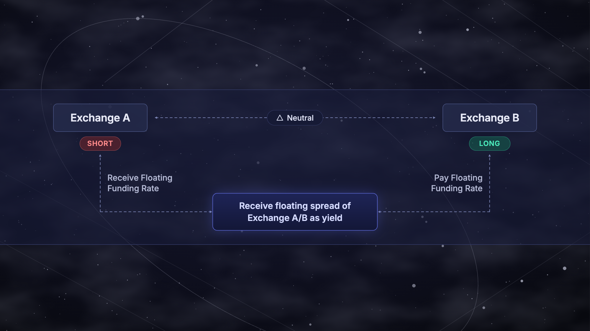
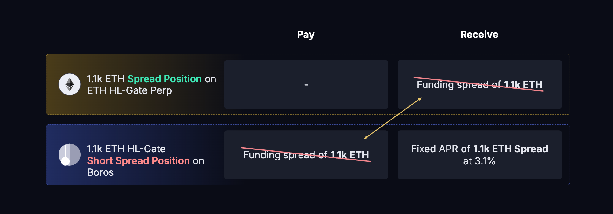
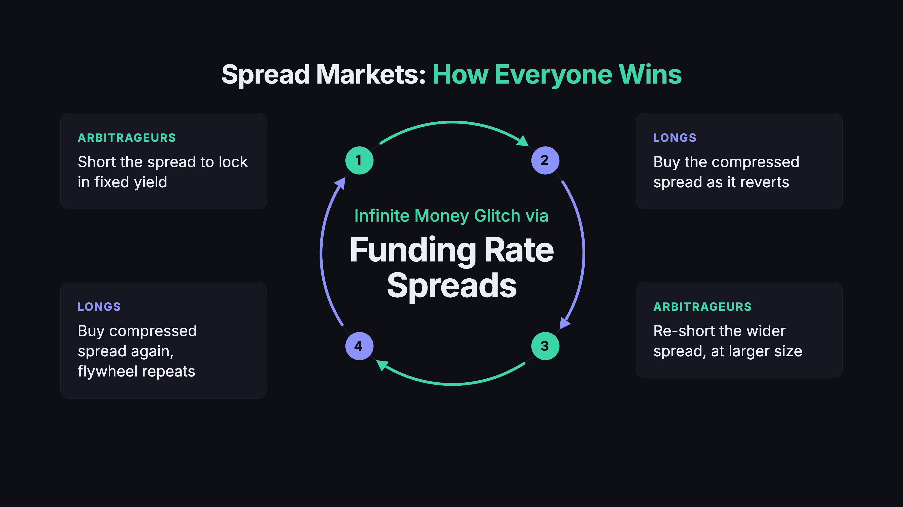

# 固定收益资金费率套利

**能否在两个永续合约市场之间，获取 Delta 中性的固定收益？**

在 Boros 出现之前，这一交易因资金费率波动风险而困难重重。如今，它已是可行、可重复的收益策略。

## 工作原理

由于各平台在流动性、交易者结构、市场情绪以及风控模型上的差异，永续合约的资金费率往往并不同步。这些结构性差异，为资金费率价差的套利创造了持续存在的机会。

## 传统裸套利（不使用 Boros）

经典做法看似简单：在两个交易所开设方向相反的永续合约头寸，赚取资金费率的价差。

**但实际操作中，运营负担相当沉重。**

**这一交易隐藏着诸多复杂性：**

* 资金费率价差是浮动的，一旦资金费率反转，你可能由盈转亏。
* **市场剧烈波动时，账户可能需要再平衡与调整，清算风险也随之上升。**

**但有了 Boros，这笔交易就变成了零方向敞口的稳定固定收益交易。**

## 通过 Boros 价差市场获取固定收益 {#fixed-returns-via-boros-spread-markets}

Boros 的[价差市场](spread-markets-101)将这一资金费率差值单独剥离出来，只需 2 步，即可轻松将浮动价差转化为固定收益。

1. **做多资金费率较低的永续合约，做空资金费率较高的永续合约**

这样你就能赚取两个资金费率之间的价差。永续合约杠杆越高，资本回报率越高，但清算风险也随之上升。注意：价差是浮动的，可能朝不利于你的方向变动。

<figure><figcaption></figcaption></figure>

2. **在 Boros 上卖出浮动价差，换取固定价差。**

**固定价差意味着固定收益。** 现在你唯一需要管理的，就是你在永续合约和 Boros 上的保证金。

只需在 Boros 上以与永续合约头寸相同的名义本金做空价差市场即可。

### 具体数字 {#what-the-numbers-look-like}

**假设 Hyperliquid 上的 ETH 资金费率高于 Gate，且 ETH HL-Gate 价差市场的隐含 APR 为 3.1%。**

你在 Hyperliquid 上做空 ETH，同时在 Gate 上做多 ETH，建立一个浮动价差头寸。

然后，你在 Boros 上以 3.1% 卖出 ETH 浮动价差，此后直至价差市场到期，你都将收取 3.1% 的 APR。

<figure><figcaption></figcaption></figure>

借助我们的[套利终端](/boros-docs/arbitrage-with-crossex/overview)，在 Boros 上捕捉此类收益机会简单又省心。终端可在应用内帮你管理永续合约头寸，你唯一需要管理的保证金只有 Boros 一侧。

多头赚取隐含价差与底层价差之间的差额，从而为希望锁定固定价差的卖方形成双赢的飞轮。其运作方式请参阅[价差市场的 PvE 特性](spread-markets-101#the-pve-nature-of-spread-markets)。

<figure><figcaption></figcaption></figure>

## 该策略的优势

借助 Boros 执行这一套利，具有以下显著优势：

* **消除资金费率波动风险。** 交易者无需担心资金费率的剧烈波动，只需关注在 Boros 上的隐含 APR 入场水平。
* **固定收益策略。** 当各平台资金费率出现分化时，Boros 允许交易者抓住时间窗口，将套利收益锁定至市场到期。
* **可执行更长周期的套利（潜在收益更高）。** 由于消除了利率波动风险，这一套利可以在更长时间区间执行，让交易者捕捉更多可获得的收益。
* **负资金费率不再是问题。** 过去执行这一套利时，资金费率转负后必须及时平仓；如今则无需如此。
* **Delta 中性敞口下持续赚取收益。** 该策略不存在方向性价格风险（已实现 Delta 中性），Boros 释放了在永续合约资金费率差异中获取收益的可能性。
* **在 Boros 上只需一个头寸。** 价差市场以单一做空价差头寸同时覆盖两个资金费率。只需一笔订单，因此不会出现只有一条腿成交的风险；且只有一个保证金要求，单一交易所利率的剧烈变动不会单独清算某一条腿。

## 使用 Boros 策略仪表板

Boros 策略仪表板让你可以快速、便捷地发现并执行套利机会。

仪表板会展示当前可用的套利机会，以及通过 Boros 可锁定的潜在固定收益。

[直接打开仪表板](https://boros.pendle.finance/strategy)，选择你想执行的套利组合，按步骤完成操作即可锁定固定收益。

注：该套利的潜在收益取决于你在永续合约一侧使用的杠杆倍数。请根据自身风险偏好，在策略计算器中调整永续合约的杠杆。

**关于该策略的详细介绍，以及在 BTC 与 ETH 上的平均收益数据，请参阅我们的[深度报告](https://x.com/boros_fi/status/2001831621817962761)。**
